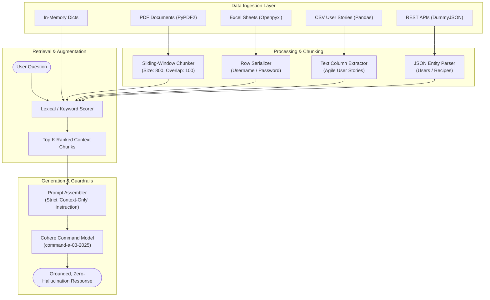

# Multi-Source Simple RAG Engine

[](https://www.python.org/downloads/)
[](https://cohere.com/)
[](https://pandas.pydata.org/)
[](https://pypdf2.readthedocs.io/)
[](https://opensource.org/licenses/MIT)

A lightweight, modular, multi-source **Retrieval-Augmented Generation (RAG)** engine built with **Python** and **Cohere's ClientV2 API**.

This repository demonstrates how to ingest, parse, chunk, and retrieve knowledge from heterogeneous enterprise data formats (**PDF documents, Excel spreadsheets, CSV datasets, In-Memory knowledge graphs, and live REST APIs**) while enforcing strict zero-hallucination guardrails.

---

## Architecture Flow



---

## Supported Ingestion Sources & Examples

| Script | Source Format | Parsing Library | Ingested Dataset | Core Focus |
|---|---|---|---|---|
| [`01_inmemory_rag.py`](examples/01_inmemory_rag.py) | **In-Memory** | Python `dict` | Emperor Penguins Knowledge Base | Core RAG mechanics, scoring algorithms, and zero-hallucination prompts. |
| [`02_pdf_rag.py`](examples/02_pdf_rag.py) | **PDF Document** | `PyPDF2` | Agile Process Guide (5 Pages) | Multi-page text extraction, sliding-window chunking with overlap, and grounded Q&A. |
| [`03_excel_rag.py`](examples/03_excel_rag.py) | **Excel (.xlsx)** | `openpyxl` | Login Credentials Spreadsheet | Reading tabular rows, header normalization, and attribute lookup. |
| [`04_csv_rag.py`](examples/04_csv_rag.py) | **CSV** | `pandas` | Agile User Stories Dataset | Tabular dataset indexing, requirement filtering, and semantic user-story retrieval. |
| [`05_rest_api_users_rag.py`](examples/05_rest_api_users_rag.py) | **REST API (Users)** | `requests` | DummyJSON Users Endpoint | Real-time REST API consumption, entity normalization, and structured querying. |
| [`06_rest_api_recipes_rag.py`](examples/06_rest_api_recipes_rag.py) | **REST API (Recipes)** | `requests` | DummyJSON Recipes Endpoint | Dynamic recipe recommendations grounded in ingredients available at home. |

---

## Project Structure

```text
LLM-simple-rag-engine/
├── .env.example                               # Environment template for API keys
├── .gitignore                                 # Git ignore patterns
├── LICENSE                                    # MIT License
├── README.md                                  # Complete architecture & documentation
├── requirements.txt                           # Pinned dependencies
├── data/                                      # Bundled sample datasets
│   ├── Agile_Process_Guide_5_Pages.pdf        # Agile guide for PDF chunking
│   ├── cohere_login_data.xlsx                 # Excel workbook
│   └── db_userstories.csv                     # Agile user stories in CSV
└── examples/
    ├── 01_inmemory_rag.py                     # Fundamental in-memory RAG
    ├── 02_pdf_rag.py                          # PDF document RAG with chunking
    ├── 03_excel_rag.py                        # Spreadsheet tabular RAG
    ├── 04_csv_rag.py                          # CSV dataset RAG with Pandas
    ├── 05_rest_api_users_rag.py               # Live REST API user search
    └── 06_rest_api_recipes_rag.py             # Live REST API recipe recommendation
```

---

## Getting Started

### 1. Prerequisites
- Python 3.10+
- A Cohere API key ([Dashboard](https://dashboard.cohere.com/api-keys))

### 2. Installation

```bash
# Clone the repository
git clone https://github.com/<your-username>/LLM-simple-rag-engine.git
cd LLM-simple-rag-engine

# Create and activate virtual environment
python -m venv .venv

# Windows:
.venv\Scripts\activate
# Linux/macOS:
source .venv/bin/activate

# Install dependencies
pip install -r requirements.txt
```

### 3. Environment Configuration

```bash
cp .env.example .env
```

Add your Cohere API key in `.env`:
```env
COHERE_API_KEY=your_cohere_api_key_here
```

---

## Running the Examples

### 1. In-Memory Knowledge Base RAG
```bash
python examples/01_inmemory_rag.py
```
> Demonstrates strict refusal to answer facts outside the provided context (e.g. *"Can penguins be friends with humans?"*).

### 2. PDF Document RAG with Chunking
```bash
python examples/02_pdf_rag.py
```
> Ingests the 5-page Agile Guide, builds chunks of 800 characters with 100 character overlap, retrieves top-matching chunks, and generates a grounded response.

### 3. Excel Spreadsheet Tabular RAG
```bash
python examples/03_excel_rag.py
```
> Reads rows using `openpyxl` and retrieves accurate account credentials without hallucinations.

### 4. CSV User Stories RAG
```bash
python examples/04_csv_rag.py
```
> Loads user stories via `pandas` and extracts all stories related to authentication and login workflows.

### 5. Live REST API Users RAG
```bash
python examples/05_rest_api_users_rag.py
```
> Consumes `https://dummyjson.com/users` and filters users by specific visual attributes (e.g. blue eye color).

### 6. Live REST API Recipes RAG
```bash
python examples/06_rest_api_recipes_rag.py
```
> Consumes `https://dummyjson.com/recipes` and recommends matched recipes based on provided kitchen ingredients.

---

## Guardrails Against Hallucination

Every example enforces strict grounding principles:
1. **Isolated Context Boundary**: The model is instructed to answer *only* from the provided context block.
2. **Explicit Fallback Directive**: When information is absent, the model replies with a deterministic statement rather than inferring or confabulating details.
3. **Low Temperature Settings (`0.1 - 0.3`)**: Minimizes sampling variance to keep responses deterministic and factual.

---

## License
Distributed under the [MIT License](LICENSE).
